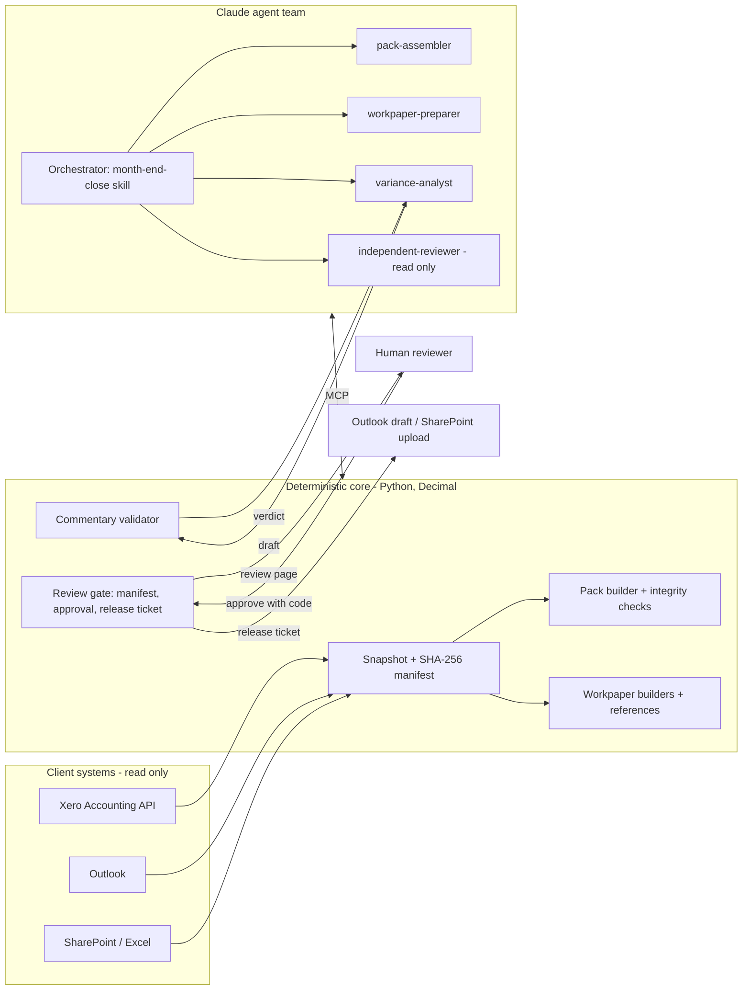

# Architecture

*For developers and technical reviewers.*

## Shape



## Principles

1. **Numbers are code's job.** Packs, variances, tie-outs and references are computed in `Decimal` from a frozen snapshot. Models never produce a figure. They select and explain evidence, and every figure they write is checked against the pack or the cited evidence.
2. **Every run is reproducible.** `var/runs/<client>/<period>/<run_id>/inputs/` holds exactly what Xero and Microsoft 365 returned, with a manifest of SHA-256 hashes. Outputs are regenerated from inputs, never from live systems.
3. **Approval binds to content.** The bundle hash covers deliverables, inputs, code, configuration and the delivery payload. Approval records that hash. Release re-verifies it.
4. **Defence in depth, with one authoritative control.** `monthend/review.py` is the control. Hooks, permission rules, subagent tool lists and the absence of an approval tool are additional layers. Each layer assumes the others might fail.

## Components

| Module | Responsibility |
|---|---|
| `sources/xero.py`, `sources/graph.py` | HTTP clients: OAuth, rate limiting, retries, pagination. Xero is read-only by construction. Graph writes require a `ReleaseTicket`. |
| `sources/backends.py` | `FixtureBackend` / `LiveBackend` write the same canonical snapshot files |
| `sources/xero_parse.py` | The only code that knows Xero's report JSON shape |
| `snapshot.py` | Hashing, manifest, tamper detection, loading |
| `pack.py` | Account mapping, pack lines, materiality, integrity checks, Excel fill by keys |
| `extraction.py` | PDF/CSV text with locators, statement and invoice parsing, reference verification |
| `evidence.py` | One addressable index of everything citable (`xero:`, `email:`, `doc:`, `wp:`) |
| `workpapers.py` | Bank reconciliation, accruals and receivables builders; Excel/markdown output |
| `variance.py` | Variance context for agents, commentary schema, validator, rule-based baseline |
| `pipeline.py` | Run lifecycle: prepare → save commentary/notes → finalise → release |
| `review.py` | Manifest, submission, approval rules, release tickets |
| `store.py` | SQLite: runs, decisions, releases, hash-chained audit events |
| `llm.py` | Direct Claude API: drafting with repair loop, grounded invoice extraction, LLM judge |
| `nightly.py` | Overnight orchestration through the Claude Agent SDK, with fallback |
| `evaluation.py` | Golden cases, label grading, validator mutation testing, thresholds |
| `mcp_servers/` | `monthend`, `xero`, `m365`, `datastore` MCP servers (FastMCP, stdio) |

## The Claude Code layer

| Piece | File | Purpose |
|---|---|---|
| Project memory | `CLAUDE.md` | The rules every session starts with |
| Orchestration skill | `.claude/skills/month-end-close/` | Sequence, stop conditions, hand-over |
| Standards as skills | `variance-commentary`, `workpaper-standards`, `review-checklist` | The firm's written standards. The API path (`llm.py`) loads the same commentary skill as its system prompt. |
| Human-only skill | `release-approved-pack` | `disable-model-invocation: true` |
| Subagents | `.claude/agents/*.md` | Least-privilege tool lists. No Bash, Write or Edit. Only the gated delivery tool can send, and no subagent has it. |
| Hooks | `.claude/hooks/` | `guard.py` (PreToolUse: blocks human-only commands, evidence tampering and ungated delivery; fails closed), `audit.py` (PostToolUse: audit log), `stop_gate.py` (Stop: one more turn if the draft fails validation), `session_start.py` (current runs as context) |
| Settings | `.claude/settings.json` | Allow/ask/deny rules; sets `MONTHEND_AGENT_SESSION` so the approval code refuses inside Claude sessions |
| MCP config | `.mcp.json` | Four stdio servers from the project's virtualenv |

### Interactive and unattended paths

- **Interactive:** a person runs `/month-end-close` in Claude Code. Project settings, hooks, skills and subagents apply. Prepare, finalise and delivery tools ask before running.
- **Unattended:** `monthend nightly` calls `claude_agent_sdk.query()` with `setting_sources=["project"]` (the same CLAUDE.md, skills, subagents and hooks), `permission_mode="dontAsk"`, an explicit allow-list, a deny-list (shell, file edits, web, delivery), `max_turns` and `max_budget_usd`. `MONTHEND_MODE=operate` makes the hooks stricter.
- **Direct API:** `llm.py` uses the Anthropic SDK with structured outputs (`output_config.format`), adaptive thinking, server-side refusal fallback, and a validator-driven repair loop. The evaluation harness uses it to score many cases without an interactive session.

## Data model

```sql
runs(run_id, client_id, period, state, backend, run_dir, inputs_sha256, bundle_sha256, state_reason, created_at, updated_at)
decisions(id, run_id, reviewer, decision, notes, bundle_sha256, os_user, decided_at)
releases(id, run_id, bundle_sha256, channel, external_ref, released_by, released_at)
events(id, ts, run_id, actor, kind, detail, prev_hash, hash)   -- hash chain
```

### Moving to Postgres or Supabase

The schema is plain SQL. To move: create the same tables (use `BIGSERIAL` for ids), swap `Store.connect()` for a `psycopg` connection, and replace `BEGIN IMMEDIATE` in `Store.event` with `SELECT ... FOR UPDATE` on the last event row, or a single-writer queue, to keep the hash chain serial. Row-level security should give the service role insert-only access to `events` and `decisions`. Run files can stay on disk or move to object storage keyed by `run_id`.

## Extension points

- **New workpaper type:** add a builder to `workpapers.BUILDERS`, list it in client config, add an evaluation case.
- **New source:** implement `SourceBackend.fetch` to write the canonical files.
- **New check:** add a `Check` in `pack._integrity_checks` or a builder, with severity `block` or `warn`, and a case in `evals/cases/` that proves it fires.
- **Cheaper models for bulk work:** the subagent `model:` field and `MONTHEND_MODEL` are configuration. The evaluation harness is how you decide whether a cheaper or open model is good enough for a task: run `monthend eval` with each and compare driver recall and validator pass rates. Extraction is the natural candidate, because its output is grounded against document text regardless of which model produced it.
